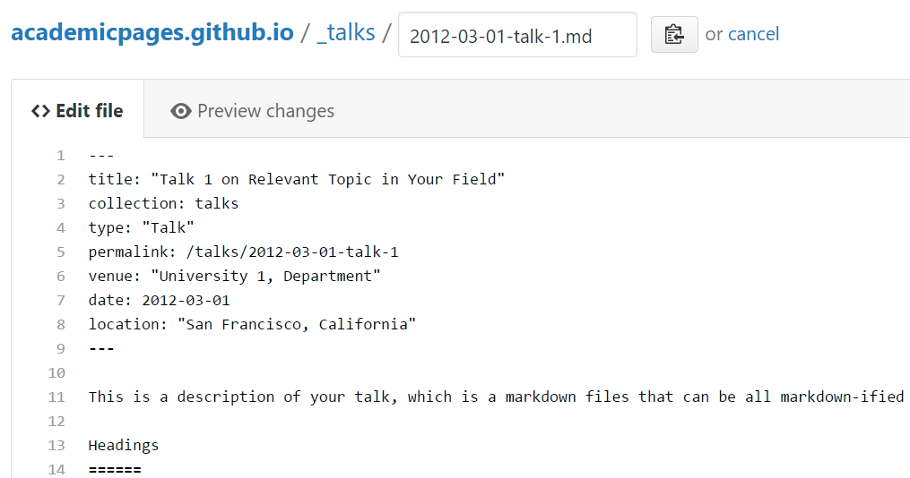

# COGNI-COREX LAB
### COGNITIVE SYSTEMS AND INTELLIGENT ELECTRONICS LABORATORY
Exploring the foundations of intelligence through neural systems, intelligent computing architectures and critical inquiry into the human–technology relationship.

## About COGNI-COREX

COGNI-COREX Lab is a research initiative dedicated to understanding, engineering and critically examining intelligence in biological, computational and technological systems.

The laboratory brings together research in neural engineering, Brain–Computer Interfaces (BCI), embedded and edge intelligence, and intelligent hardware architectures. It explores how intelligent computational models can be designed, optimised and implemented efficiently across resource-constrained electronic platforms.

Beyond engineering, COGNI-COREX encourages interdisciplinary and philosophical inquiry into human cognition, artificial intelligence, technological dependence and the evolving relationship between humans and intelligent machines.

Our research connects the understanding of intelligence with the engineering of intelligent systems and critical reflection on their role in society.

## Research Domains

Our research is organised around four interconnected domains, spanning neural intelligence, embedded computing, intelligent hardware and techno-cognitive inquiry.

  <h3>🧠 01. Neural Intelligence and Brain–Computer Interfaces</h3>
  
Exploring neural systems and computational models of intelligence through BCI, EEG signal processing, brain-inspired computing and neural network architectures.

  <h3>⚙️ 02. Embedded and Edge Intelligence</h3>
  
Developing efficient intelligent systems through TinyML, embedded deep learning, low-power Edge AI, model optimisation and resource-aware inference.

  <h3>▧ 03. Intelligent Hardware and Computing Architectures</h3>
  
Investigating FPGA-based AI acceleration, VLSI architectures, System-on-Chip design, hardware–software co-design and energy-efficient computing.

  <h3>💡 04. Techno-Cognitive Studies and Critical Technology Inquiry</h3>
  
Examining human cognition, human–technology interaction, artificial intelligence, technological dependence, human agency and the philosophical implications of technological advancement.

## Our Research Approach

COGNI-COREX connects three complementary dimensions of research:

### Understand Intelligence

Investigating biological cognition, neural systems and computational intelligence to explore how intelligence emerges, operates and can be modelled.

### Engineer Intelligent Systems

Designing and implementing efficient computational models, electronic architectures and hardware platforms for intelligent applications.

### Question Technology

Critically examining the purpose, limitations and implications of technological advancement, particularly its influence on human cognition, autonomy and society.

We believe that understanding intelligence, engineering intelligent systems and questioning technological progress should be interconnected pursuits.

## Featured Research

Our research explores the development, optimisation and implementation of intelligent systems across neural engineering, embedded computing and hardware architectures.

Selected research projects include:

- **EEG-Based Brain–Computer Interface Systems:** Neural signal processing and computational approaches for brain–computer interaction.
- **TinyML and Edge AI on Embedded Platforms:** Development and deployment of lightweight deep learning models on resource-constrained microcontrollers.
- **FPGA-Based AI Acceleration:** Investigation of specialised hardware architectures for efficient neural network inference.
- **Resource-Efficient Deep Learning Architectures:** Model optimisation, quantisation and hardware-aware implementation of intelligent systems.
- **Human-Centred Technology Research:** Critical examination of artificial intelligence, human agency and the implications of technological advancement.

Research projects will be progressively documented with their objectives, methodologies, implementations and outcomes.

## Research Philosophy

Intelligence is more than computational capability, and technological advancement is more than the ability to build increasingly powerful systems.

At COGNI-COREX, we explore not only how intelligence can be understood, modelled and engineered, but also how intelligent technologies influence human cognition, autonomy and society.

We believe that technological innovation must be accompanied by critical thinking, responsible engineering and reflection on its broader implications.

### Just because we can, should we?

This question represents our commitment to questioning technological assumptions, examining the consequences of innovation and keeping human values central to technological progress.

## Selected Publications

Our research contributions address neural engineering, embedded intelligence, computational architectures and emerging technologies.

Explore our journal articles, conference publications and other academic contributions through the Publications section of this website.

[View All Publications](/publications/)

## Research Resources

COGNI-COREX promotes practical experimentation, reproducible research and open-source knowledge sharing.

Our research resources include:

- Embedded AI hardware and software implementations
- Neural signal processing tools and implementations
- FPGA-based computing architectures
- Research datasets and experimental resources
- Technical documentation and research tutorials

Explore our research implementations and open-source contributions on GitHub.

[Visit GitHub](https://github.com/SivanandaReddy-C)

## Research Collaboration

COGNI-COREX welcomes academic collaborations, interdisciplinary research interactions and technical engagements in:

- Neural engineering and Brain–Computer Interfaces
- Embedded and Edge AI
- Intelligent hardware and computing architectures
- FPGA-based AI acceleration
- Human cognition and artificial intelligence
- Human–technology interaction
- Critical and philosophical studies of technology

We are particularly interested in research that connects engineering, neuroscience, computational intelligence and philosophy to investigate emerging questions about intelligence and technology.

For research collaboration and academic enquiries, please get in touch through the contact information provided on this website.

---

## COGNI-COREX LAB

**Engineering Intelligence. Questioning Technology.**

*Understanding intelligence. Engineering intelligent systems. Rethinking technology.*

---
This is the front page of a website that is powered by the [Academic Pages template](https://github.com/academicpages/academicpages.github.io) and hosted on GitHub pages. [GitHub pages](https://pages.github.com) is a free service in which websites are built and hosted from code and data stored in a GitHub repository, automatically updating when a new commit is made to the repository. This template was forked from the [Minimal Mistakes Jekyll Theme](https://mmistakes.github.io/minimal-mistakes/) created by Michael Rose, and then extended to support the kinds of content that academics have: publications, talks, teaching, a portfolio, blog posts, and a dynamically-generated CV. Incidentally, these same features make it a great template for anyone that needs to show off a professional template!

 You can fork [this template](https://github.com/academicpages/academicpages.github.io) right now, modify the configuration and Markdown files, add your own PDFs and other content, and have your own site for free, with no ads!

A data-driven personal website
======
Like many other Jekyll-based GitHub Pages templates, Academic Pages makes you separate the website's content from its form. The content & metadata of your website are in structured Markdown files, while various other files constitute the theme, specifying how to transform that content & metadata into HTML pages. You keep these various Markdown (.md), YAML (.yml), HTML, and CSS files in a public GitHub repository. Each time you commit and push an update to the repository, the [GitHub pages](https://pages.github.com/) service creates static HTML pages based on these files, which are hosted on GitHub's servers free of charge.

Many of the features of dynamic content management systems (like Wordpress) can be achieved in this fashion, using a fraction of the computational resources and with far less vulnerability to hacking and DDoSing. You can also modify the theme to your heart's content without touching the content of your site. If you get to a point where you've broken something in Jekyll/HTML/CSS beyond repair, your Markdown files describing your talks, publications, etc. are safe. You can rollback the changes or even delete the repository and start over - just be sure to save the Markdown files! You can also write scripts that process the structured data on the site, such as [this one](https://github.com/academicpages/academicpages.github.io/blob/master/talkmap.ipynb) that analyzes metadata in pages about talks to display [a map of every location you've given a talk](https://academicpages.github.io/talkmap.html).

For those users that need more advanced functionality, the template also supports the following popular tools:
- [MathJax](https://www.mathjax.org/) for mathematical equations
- [Mermaid](https://mermaid.js.org/) for diagraming
- [Plotly](https://plotly.com/javascript/) for plotting

Getting started
======
1. Register a GitHub account if you don't have one and confirm your e-mail (required!)
1. Fork [this template](https://github.com/academicpages/academicpages.github.io) by clicking the "Use this template" button in the top right. 
1. Go to the repository's settings (rightmost item in the tabs that start with "Code", should be below "Unwatch"). Rename the repository "[your GitHub username].github.io", which will also be your website's URL.
1. Set site-wide configuration and create content & metadata (see below -- also see [this set of diffs](https://archive.is/3TPas) showing what files were changed to set up [an example site](https://getorg-testacct.github.io) for a user with the username "getorg-testacct")
1. Upload any files (like PDFs, .zip files, etc.) to the files/ directory. They will appear at https://[your GitHub username].github.io/files/example.pdf.  
1. Check status by going to the repository settings, in the "GitHub pages" section

Site-wide configuration
------
The main configuration file for the site is in the base directory in [_config.yml](https://github.com/academicpages/academicpages.github.io/blob/master/_config.yml), which defines the content in the sidebars and other site-wide features. You will need to replace the default variables with ones about yourself and your site's github repository. The configuration file for the top menu is in [_data/navigation.yml](https://github.com/academicpages/academicpages.github.io/blob/master/_data/navigation.yml). For example, if you don't have a portfolio or blog posts, you can remove those items from that navigation.yml file to remove them from the header. 

Create content & metadata
------
For site content, there is one Markdown file for each type of content, which are stored in directories like _publications, _talks, _posts, _teaching, or _pages. For example, each talk is a Markdown file in the [_talks directory](https://github.com/academicpages/academicpages.github.io/tree/master/_talks). At the top of each Markdown file is structured data in YAML about the talk, which the theme will parse to do lots of cool stuff. The same structured data about a talk is used to generate the list of talks on the [Talks page](https://academicpages.github.io/talks), each [individual page](https://academicpages.github.io/talks/2012-03-01-talk-1) for specific talks, the talks section for the [CV page](https://academicpages.github.io/cv), and the [map of places you've given a talk](https://academicpages.github.io/talkmap.html) (if you run this [python file](https://github.com/academicpages/academicpages.github.io/blob/master/talkmap.py) or [Jupyter notebook](https://github.com/academicpages/academicpages.github.io/blob/master/talkmap.ipynb), which creates the HTML for the map based on the contents of the _talks directory).

**Markdown generator**

The repository includes [a set of Jupyter notebooks](https://github.com/academicpages/academicpages.github.io/tree/master/markdown_generator
) that converts a CSV containing structured data about talks or presentations into individual Markdown files that will be properly formatted for the Academic Pages template. The sample CSVs in that directory are the ones I used to create my own personal website at stuartgeiger.com. My usual workflow is that I keep a spreadsheet of my publications and talks, then run the code in these notebooks to generate the Markdown files, then commit and push them to the GitHub repository.

How to edit your site's GitHub repository
------
Many people use a git client to create files on their local computer and then push them to GitHub's servers. If you are not familiar with git, you can directly edit these configuration and Markdown files directly in the github.com interface. Navigate to a file (like [this one](https://github.com/academicpages/academicpages.github.io/blob/master/_talks/2012-03-01-talk-1.md) and click the pencil icon in the top right of the content preview (to the right of the "Raw | Blame | History" buttons). You can delete a file by clicking the trashcan icon to the right of the pencil icon. You can also create new files or upload files by navigating to a directory and clicking the "Create new file" or "Upload files" buttons. 

Example: editing a Markdown file for a talk

For more info
------
More info about configuring Academic Pages can be found in [the guide](https://academicpages.github.io/markdown/), the [growing wiki](https://github.com/academicpages/academicpages.github.io/wiki), and you can always [ask a question on GitHub](https://github.com/academicpages/academicpages.github.io/discussions). The [guides for the Minimal Mistakes theme](https://mmistakes.github.io/minimal-mistakes/docs/configuration/) (which this theme was forked from) might also be helpful.
